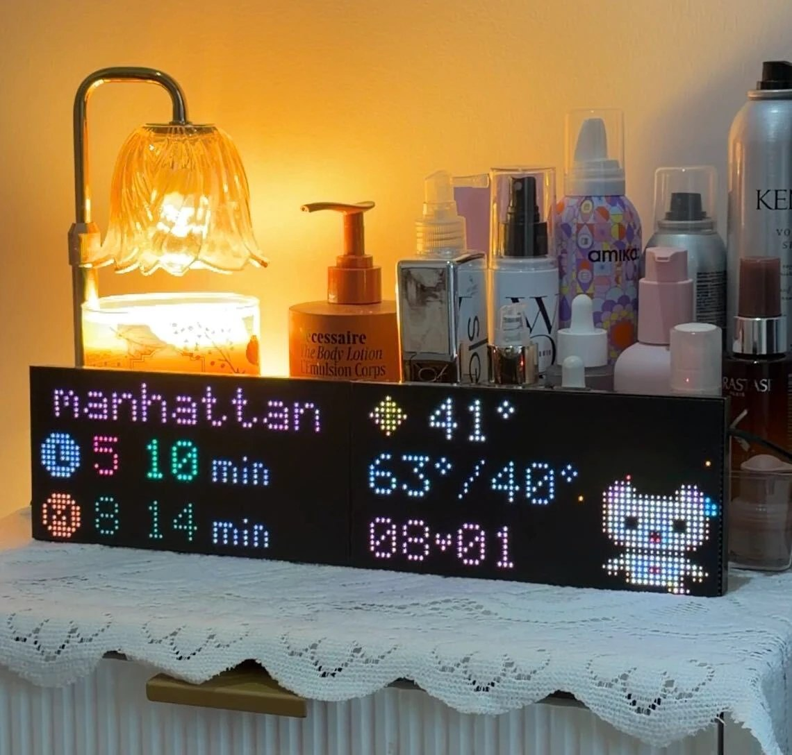
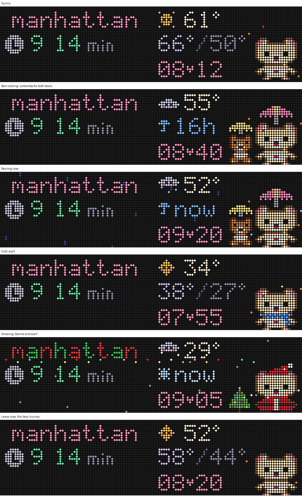
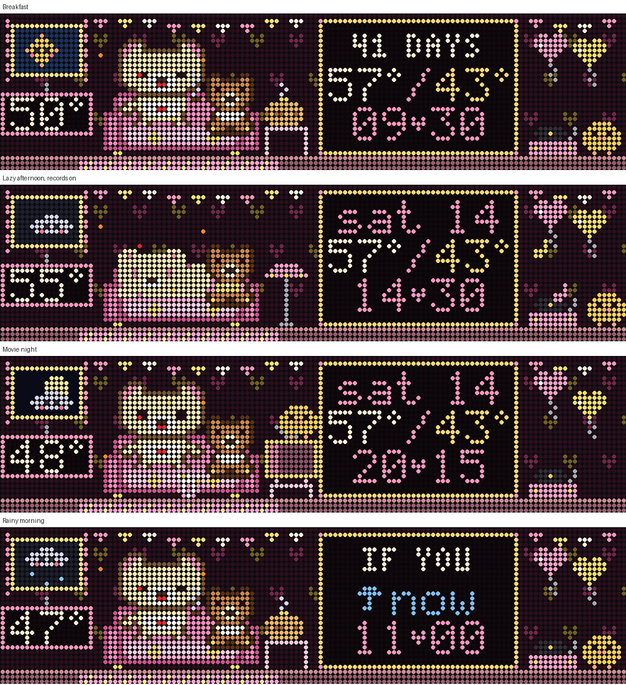
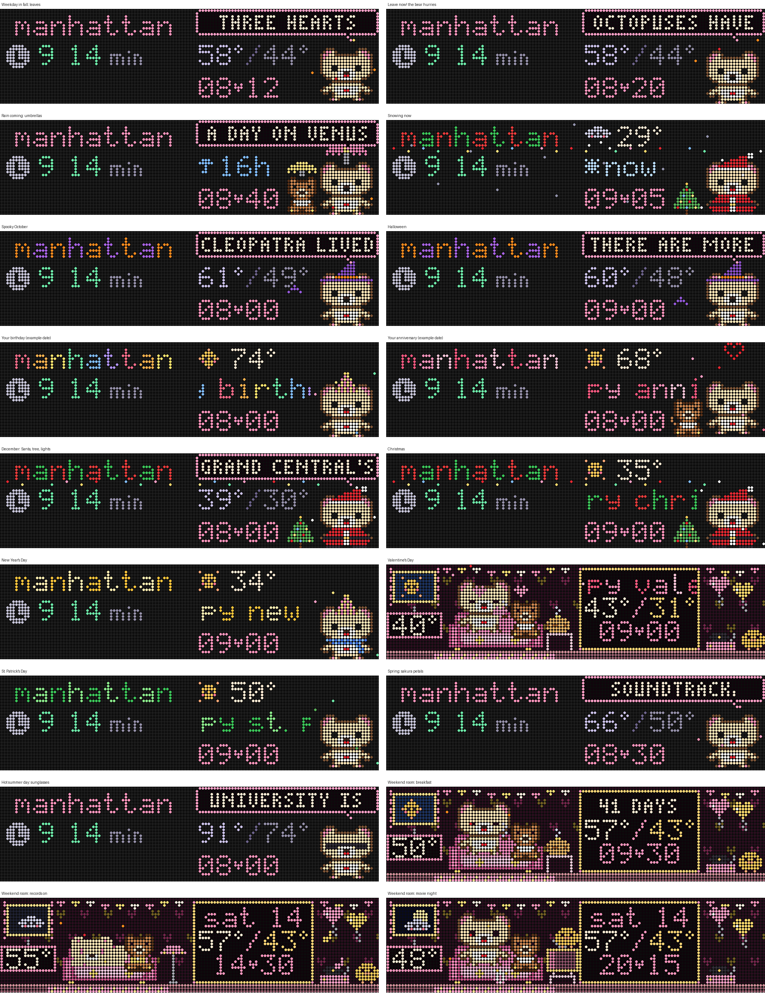

# nyc train board

an LED sign for my room that shows when the next subway trains leave my
station, plus the weather and a clock. It runs on a Raspberry Pi driving two
64×32 RGB LED panels (128×32 total). Korilakkuma, Chairoikoguma and Kiiroitori
hang out in the corner and change outfits with the weather and the holidays.





## Setup for your own station

Copy `my_settings.example.py` to `my_settings.py` and fill in your station, the
location to get weather for, and any birthdays, anniversaries or countdowns you
want. `my_settings.py` is in `.gitignore`, so it stays out of the repo. Anything
you don't set falls back to the defaults at the top of `train_board.py`.

## What it shows

**Trains (left panel).** The next two trains on each line that you can still make,
given how long it takes you to walk to the platform (`walk_min`). Times are colored
by when you need to leave: mint if you have time, yellow if you should leave in the
next couple of minutes, and blinking pink if you need to go now. A dimmer time means
the train hasn't left its first stop yet, so it's a schedule estimate rather than a
live one. If a line has nothing coming, its row scrolls the MTA's service alert.

**Weather and time (right panel).** Current temperature with an animated icon,
today's high and low, and a 24-hour clock. If rain or snow is likely in the next
12 hours, the high/low is replaced with an umbrella or snowflake and the hour it
starts. While it's actually raining or snowing, faint drops fall across the whole
board.

**Kori** Korilakkuma reacts to the weather (umbrella, scarf, beanie,
sunglasses), hurries when it's time to leave, and falls asleep at night.
Chairoikoguma shows up when it rains and at the times in `BUDDY_TIMES`.

**Mornings.** Until noon, Korilakkuma says something in a speech bubble every
couple of minutes: a random fact or question from `MORNING_MESSAGES`, one per day
in shuffled order, alternating with countdowns from `COUNTDOWNS` ("12 days until
christmas!").

**Weekends.** Since I'm not typically in a rush on weekends, the whole board turns into a small
room instead of train times. The window shows the actual weather, the date and
time are on a board on the wall, and the bears do different things depending on
the time of day: breakfast, music in the afternoon, a movie at night, then bed.
Set `WEEKEND_SCENE = False` to keep the trains every day.



**Seasons and holidays.** The header changes color and the bears dress up!!

Birthdays and anniversaries come from `PERSONAL_DAYS` in your settings.



**Schedule.** The screen is only on when I'd look at it: 7–10am on weekdays and
9am–1am on weekends (`WEEKDAY_ON/OFF`, `WEEKEND_ON/OFF`). The rest of the time it's
dark, but the Pi stays on so the data is current when it wakes up.

**Data.** MTA GTFS-realtime feeds and service alerts, and weather from
[Open-Meteo](https://open-meteo.com). None of them need an API key.

## Hardware

- Raspberry Pi 3 B+ (a Pi 4 works too; set `GPIO_SLOWDOWN = 4`)
- 5V 2.5A micro-USB power supply for the Pi
- microSD card, 16 GB or more
- 2× 64×32 HUB75 RGB LED panels, P3 or P4 (mine are Waveshare RGB-Matrix-P3-64x32).
  Buy both from the same listing so they match. They should come with a ribbon
  cable and a power cable.
- 5V power supply for the panels, 8–10A (make sure it's 5V, not 12V)
- DC barrel jack to screw terminal adapter, matching the supply's plug
- 14 female-to-female jumper wires
- Optional: a frosted acrylic sheet in front of the panels softens the LEDs a lot

There's no HAT or soldering; the Pi is wired straight to the panel with jumpers.
If you use an Adafruit RGB Matrix Bonnet instead, set `WIRING = "adafruit-hat"`.

## Wiring
### Pi to the first panel

Use the panel's input connector (the one with arrows pointing away from it, or the
small buffer chips next to it). If the pins are labeled, go by the labels.

| Panel pin | Pi physical pin | GPIO |
|---|---|---|
| R1  | 23 | 11 |
| G1  | 13 | 27 |
| B1  | 26 | 7 |
| R2  | 24 | 8 |
| G2  | 21 | 9 |
| B2  | 19 | 10 |
| A   | 15 | 22 |
| B   | 16 | 23 |
| C   | 18 | 24 |
| D   | 22 | 25 |
| CLK | 11 | 17 |
| LAT/STB | 7 | 4 |
| OE  | 12 | 18 |
| GND | 6  | ground |

Leave E unconnected; 64×32 panels don't use it.

If your panel has no labels (the Waveshare ones don't), hold it so the buffer chips
next to the input connector are on the right and the "up" arrows point up. The pins
are then, from the top:

```
 row   left          right
  1    R1  (Pi 23)   G1  (Pi 13)
  2    B1  (Pi 26)   GND (Pi 6)
  3    R2  (Pi 24)   G2  (Pi 21)
  4    B2  (Pi 19)   E   (unused)
  5    A   (Pi 15)   B   (Pi 16)
  6    C   (Pi 18)   D   (Pi 22)
  7    CLK (Pi 11)   LAT (Pi 7)
  8    OE  (Pi 12)   GND (leave empty)
```

On the Pi, pin 1 is the header pin closest to the SD card end, on the inner row.
Odd pins are on the inner row and even pins on the outer edge. This is the
"regular" mapping from the
[rpi-rgb-led-matrix wiring guide](https://github.com/hzeller/rpi-rgb-led-matrix/blob/master/wiring.md).

### Second panel and power

Run the ribbon cable from the first panel's output to the second panel's input.
The panels' power cable goes to the screw terminal adapter (red to +, black to −),
and the adapter plugs into the 5V supply. The Pi has its own power supply; the
ground jumper on pin 6 connects the two.

### Troubleshooting

- **Completely dark:** usually OE, CLK or LAT is one pin off. `wire_check.sh` helps:
  run `sudo bash wire_check.sh` on the Pi, then touch each wire's panel end to Pi
  pin 40 and it prints which signal that wire carries.
- **Flicker or garbage:** raise `GPIO_SLOWDOWN` (3, 4, 5).
- **Wrong colors or scrambled rows:** an R/G/B or A/B/C/D wire is swapped.
- **Halves swapped:** the jumpers are on the wrong panel; move them to the other one.

Once everything works, a dab of hot glue on the jumper plugs keeps them from
working loose.

## Software

### Preview on a laptop

```bash
python3 -m venv .venv
.venv/bin/pip install -r requirements.txt
.venv/bin/python train_board.py --terminal                    # live, in the terminal
.venv/bin/python train_board.py --png frame.png               # one frame as an image
.venv/bin/python train_board.py --terminal --pretend "2026-12-25 09:00"  # any date/time
```

### Raspberry Pi

1. Flash Raspberry Pi OS Lite (64-bit) with Raspberry Pi Imager. In its settings,
   set the username to `pi`, enter your Wi-Fi and turn on SSH.
2. Copy the project to `~/train-board` on the Pi, including your `my_settings.py`.
3. Run `bash setup.sh` from that folder. It installs everything, builds the LED
   library, sets the board to start on boot, and reboots. Takes about 20 minutes
   on a Pi 3.

`setup.sh` also turns off Wi-Fi power saving, enables the hardware watchdog, and
gives the LED driver its own CPU core.

The LED library's Python bindings need a few of Pillow's C headers that pip doesn't
install; `setup.sh` downloads them to match the Pillow version in
`requirements.txt`. If you change that version, change `PILLOW` in `setup.sh` too.

### Read-only mode

Cutting power to a Pi while it's writing can corrupt the SD card. Mine lost its
Wi-Fi settings twice that way. Once everything works, make the filesystem
read-only so the power switch is safe to use:

```bash
sudo raspi-config nonint do_overlayfs 0 && sudo reboot
```

To update the code later, turn it off (`do_overlayfs 1`), reboot, copy the new
files, then turn it back on.

Logs: `journalctl -u train-board -f`

## Settings

All of these can go in `my_settings.py`:

- `LINES`: stations, walk times, and which stops count for service alerts
- `HEADER`: the text above the train rows
- `LAT`, `LON`: weather location
- `PERSONAL_DAYS`, `HOLIDAYS`: `"MM-DD": (theme, message)`
- `COUNTDOWNS`: `("name", "MM-DD")` for yearly, `("name", "YYYY-MM-DD")` for one-time
- `MORNING_MESSAGES`, `MORNING_UNTIL`, `PAGE_S`: what Korilakkuma says, until when,
  and how fast
- `WEEKDAY_ON/OFF`, `WEEKEND_ON/OFF`: when the screen is on
- `WEEKEND_SCENE`, `WEEKEND_DAYS`
- `BRIGHTNESS_DAY`, `BRIGHTNESS_NIGHT`
- `COLD_F`, `HOT_F`, `RAIN_CHANCE`, `RAIN_LOOKAHEAD_H`
- `LETTER_CASE`: `"lower"` or `"upper"`
- `GPIO_SLOWDOWN`, `WIRING`

Sprites are drawn as text grids in `train_board.py`, so they're easy to edit.

---
